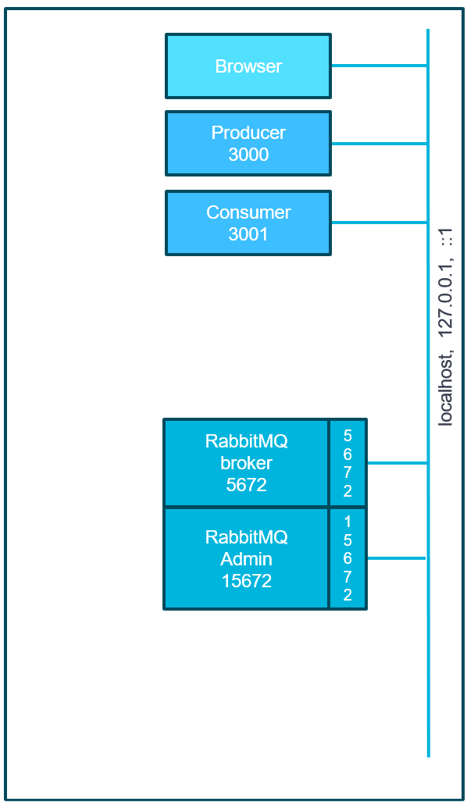
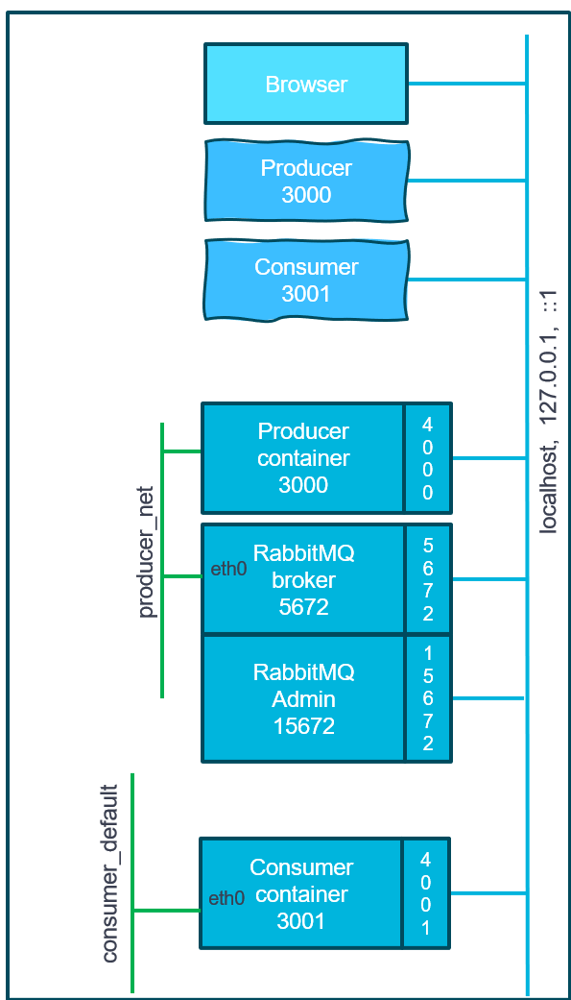
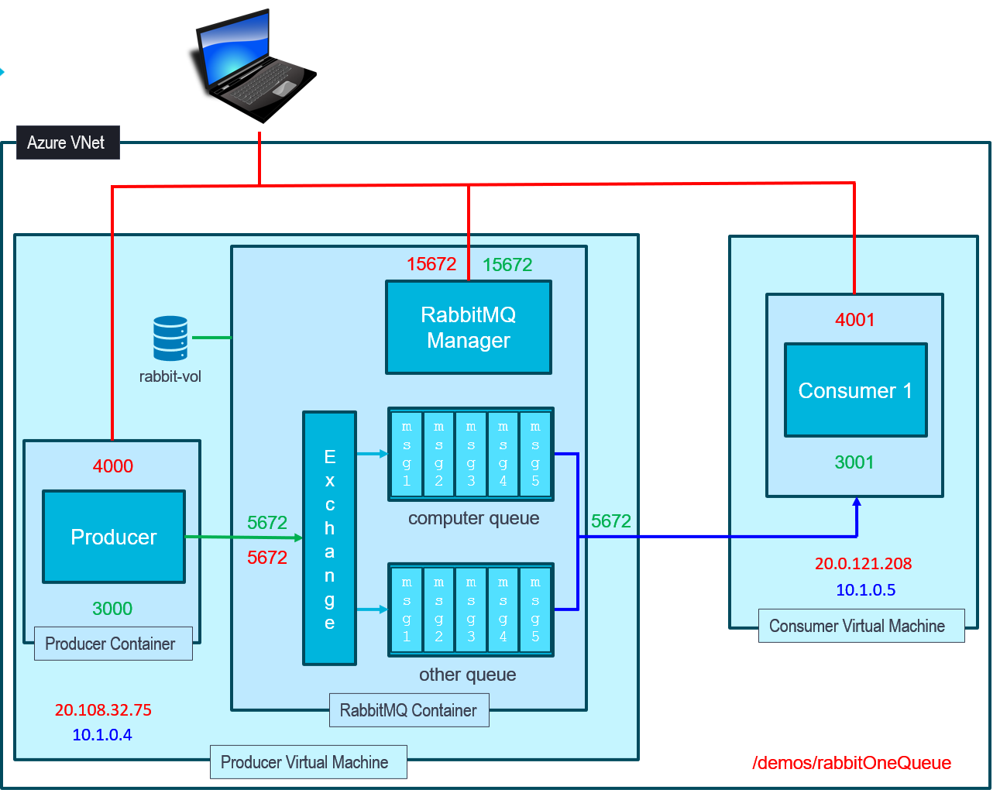

# RabbitMQ Message Broker
This demo creates a producer and consumer application and starts an MQ message broker 

Messages created by the producer are sent to the queue on the broker and the consumer reads and removes the messages

There are three build approaches: 
1. Run in vscode to debug using the provided launch.json
2. Build and run the demo in local containers to test them
3. Deploy the containers to two cloud VMs: Producer and Broker containers on one and Consumer on the other. The consumer connects to the broker using the producer vm private IP address

## Endpoints
The **producer** generates one or more random messages and post to the queue  
**GET /rand**  
Optional query values are:  
**cat** which specifies the category/topic/queue name (all mean the same thing in this case)  
**num** which specifies the number of random messages to create and send to the queue  

e.g.  
GET http://localhost:3000/rand?cat=computer&num=5

The **producer** send one custom message to the queue

**POST /msg** 

e.g.  
POST http://localhost:3000/msg  
Content-Type: application/json  
{  
"category": "computer",  
"make": "Dell",  
"device": "laptop",  
 "cost": 8000  
}  

The **consumer** can get a single message from the queue  
**GET /msg**  
e.g.  
GET http://localhost:3001/msg

To test this endpoint to get a single message from the queue, you need to edit the consumer.js file and comment out  
**startMsgListener(gChannel, QUEUE_NAME);**
to stop the callback being started as it will consume all the messages before you get a chance to request one

## VScode
**Architecture for this section**

Run in the debugger using the launch.json. This enables debugging of producer and consumer at the same time

The application port numbers are 3000 for producer and 3001 for the consumer

You will need to start a RabbitMQ container first. Just go into the producer directory and run:  
**docker compose up -d --build**

This will also run the producer in a container but we're not using that and it is on a different port to the VScode app so there is no conflict

You can monitor the queue by connecting to the administration console from the browser at **localhost:15672**  
The user name and password are both **admin**

## Containers
**Architecture for this section**  

Start Docker desktop

From the producer dir, **docker compose up -d --build**  

For the consumer to connect to the producer, you need to change the hostname in the consumer compose file from  
 **- RMQ_HOST=rabbitmq** to  
 **- RMQ_HOST=host.docker.internal**  
 or join the two docker networks

From the consumer dir, **docker compose up -d --build**

All three containers should be running. Use the endpoints in the **.rest** file to test them. By default the producer is listening on port 4000 and the consumer on 4001

You can monitor the queue by connecting to the administration console from the browser at **localhost:15672**  
The user name and password are both **admin**

## Cloud Deployment
**Architecture for this section**  

Create two cloud VMs, one for the producer containers and one for the consumer

**Note:** in Azure, if you're creating these from the portal, use the same resource group for both VMs or they will be placed in different networks and won't be able to communicate with each other

On the producer VM, open ports **22, 4000** and **15672**
On the consumer VM, open ports **22** and **4001**

Change the consumer's compose.yaml file to reflect the new host address for the producer at the producer's private IP address. e.g.,  
**- RMQ_HOST=10.0.0.4**  Look for the actual address in the cloud console

Your container images will already be built if you followed the previous steps. If not, just build them. No need to run them  
**docker compose build** from the producer dir and from the consumer dir

Push these to your repo  
**docker push** repoName/imageName

Copy the producer **compose.yaml** file and **docker-az-swap.sh** to the producer VM  
Copy the consumer **compose.yaml** file and **docker-az-swap.sh** to the producer VM

login to the VMs  
**ssh -i** pathToSecretKey adminName@IPaddress

On each vm install docker: **bash docker-az-swap.sh**  
Check it's installed: **docker -v**  

Start the containers on each VM: **docker compose up -d**  

Use the **.rest** file to test your deployment having replaced the appropriate IP addresses in the endpoints

To see the consumed messages on the consumer vm use:  
**docker logs -f consumer**

This will log all the output from the running container

To exit this, use ctrl-c

## Finally
Don't forget to delete the resource group to stop paying for resources you've finished with

